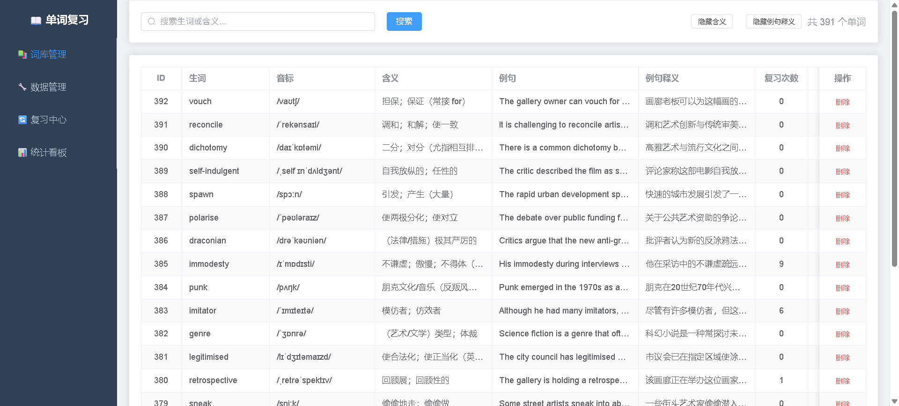
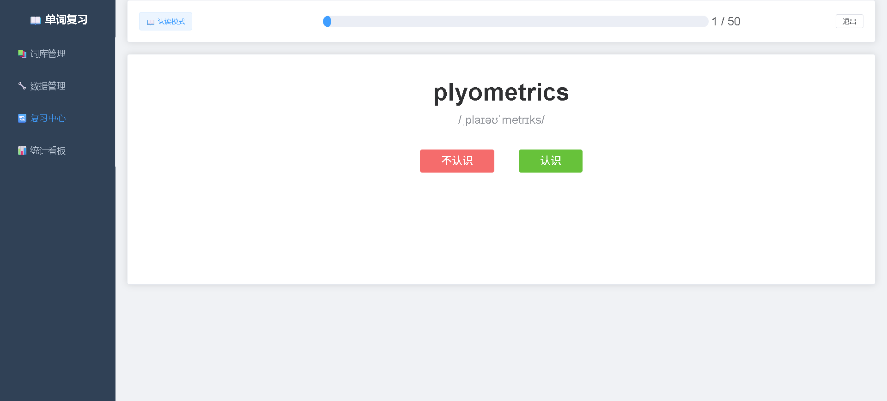
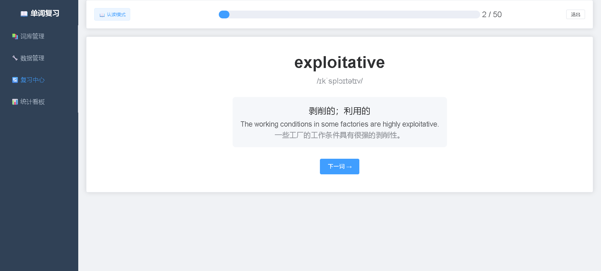

# 📖 Word Review Pro — 本地智能单词复习系统

> 基于 Spring Boot + Vue 3 的本地桌面端单词复习工具。核心价值是**智能调度算法**：高频打击顽固生词 + 强制唤醒长期沉睡词，杜绝单词"永久沉底"。

---

## ✨ 功能特性

- 📥 **Excel 导入 / 导出** — 支持 `.xls` / `.xlsx`，Upsert 去重更新并保留复习统计；导出按词组分 Sheet
- 🤖 **AI 批量导入** — 粘贴一列单词，DeepSeek / 通义千问自动还原原型并补齐音标、全部释义、雅思例句
- 🧠 **智能调度算法** — 三级筛选（强制召回 → 综合评分 → 随机抽样），兼顾紧急度与饥饿度
- 📖 **四阶段复习** — 认读 → 拼写练习 → 默写 → 听音默写，"认识"不等于"会写"
- 🎯 **五种复习模式** — 完整复习 / 仅认读 / 仅拼写练习 / 仅默写 / 仅听音默写，词库页还可勾选单词自定义阶段组合
- 🗂️ **词组树管理** — 父子层级词组、单词与词组多对多、按词组筛选（含子孙）、批量调整归属
- 🔊 **内置发音** — Java 原生实现 Edge TTS（WebSocket 协议），生成后本地缓存，离线可播
- 📊 **统计看板** — 词库概览、易错词 Top 5、长期未复习词等 ECharts 可视化
- 💾 **零配置持久化** — H2 文件数据库 `~/worddb.mv.db`，重启不丢数据，无需安装 MySQL
- 📦 **一键分发** — `./release.sh` 打出含内置 JRE 的压缩包，对方双击即用，无需装 Java
- 🎯 **单机即用** — 无需登录，数据只存本机不上传；除首次生成发音需联网外全程离线

---

## 📸 界面预览

> 📌 下列截图取自早期版本，界面已有更新：现在左侧多了一个**「词组管理」**，
> 词库管理页也增加了词组筛选、编辑、勾选批量调组和自定义复习，数据管理页增加了「导出为 Excel」。

### 词库管理

按词组筛选单词，支持搜索、服务端排序、分页、编辑、删除、批量调整词组、
批量生成发音，勾选后可自定义阶段发起复习。



### 数据管理

Excel 导入（需先选目标词组）、按词组分 Sheet 导出，以及 JSON 全量备份 / 恢复。


### 复习中心

四阶段复习入口，支持五种模式，顶部显示批次大小和进度，可调整复习配置。


### 认读复习

展示英文单词和音标，点击"认识"或"不认识"后立即显示释义和例句，强化记忆。

| 认读 | 显示释义 |
|:---:|:---:|
|  |  |

### 默写复习

展示中文含义，输入英文单词校验拼写，忽略大小写和首尾空格。


### 统计看板

ECharts 可视化展示词库总量、易错词排行、长期未复习词等数据。


---

## 🛠 技术栈

| 层级 | 技术 | 版本 |
|:---|:---|:---|
| **后端** | Spring Boot + Spring Data JPA | 2.7.18 |
| **数据库** | H2 (文件模式) | 内嵌 |
| **Excel 解析** | Apache POI | 5.2.5 |
| **前端** | Vue 3 + Vite | 3.5.x / 8.x |
| **UI 组件库** | Element Plus | 2.14.x |
| **图表** | ECharts | 6.x |
| **HTTP** | Axios | 1.18.x |
| **路由** | Vue Router | 4.x |
| **工具** | Lombok | — |

---

## 📁 项目结构

```
vocabulary-review/
├── review-backend/                        # Spring Boot 后端
│   ├── pom.xml                            # 含 release profile：把前端产物打进 jar
│   ├── audio/                             # TTS 音频缓存（约 4187 个 mp3 / 49MB，已入版本库）
│   └── src/main/
│       ├── resources/application.yml      # 数据源 / 默认端口 8080 / 音频目录
│       └── java/com/wordreview/
│           ├── WordReviewApplication.java     # 启动类
│           ├── entity/                        # Word / ReviewConfig / WordGroup / WordGroupMember
│           ├── repository/                    # 对应四个 Repository
│           ├── service/                       # 调度、Excel 导入导出、JSON 备份、词组、Edge TTS、统计、AI 配置与解析
│           ├── controller/                    # /api/words /review /stats /audio /groups
│           ├── config/SpaFallbackConfig.java  # 发布包 SPA 路由回退（dev 环境自动跳过）
│           ├── entity/AiConfig.java           # AI 配置单例行（独立于词库，不进备份）
│           └── dto/                           # 请求 / 响应 DTO
│
├── review-frontend/                       # Vue 3 前端
│   ├── vite.config.js                     # dev 代理 /api、/audio → localhost:8080
│   └── src/
│       ├── main.js / App.vue / style.css
│       ├── api/index.js                   # Axios 封装
│       ├── router/index.js                # 路由: /words /groups /data /review /stats /ai
│       ├── utils/group.js                 # 词组树加载 / 树选项转换 / 默认词组查找
│       ├── views/AiSettings.vue            # AI 设置页（/ai）
│       ├── components/Layout.vue          # 左菜单 + 右内容
│       └── views/                         # 词库 / 词组 / 数据 / 复习 / 统计 五个页面
│
├── packaging/                             # 发布包内的启动脚本与说明文档
│   ├── start.sh                           # macOS / Linux 启动（打包时另存为 Start.command）
│   ├── start.bat                          # Windows 启动
│   ├── application.properties             # 用户可改端口：server.port=8080
│   ├── README.txt                         # 一页纸速查（记事本可直接打开）
│   └── README.md                          # 小白上手指南 + 常见问题全解
│
├── release.sh                             # 一键打包 → release/WordReviewPro-<版本>-<系统>.zip
├── dev.sh / dev.cmd / dev.ps1             # 开发用一键启停（前后端分离）
├── data/                                  # JSON 数据备份
├── imgs/                                  # README 截图
└── 本地智能单词复习系统.md                 # 需求文档
```

---

## 🚀 快速开始

### 环境要求

- **Java**: JDK 11+（推荐 JDK 17）
- **Maven**: 3.6+
- **Node.js**: 16+

### 方式一：一键启动（推荐）

**Windows CMD:**
```bash
dev.cmd start
```

**Windows PowerShell:**
```powershell
.\dev.ps1 start
```

**Linux / Mac:**
```bash
chmod +x dev.sh
./dev.sh start
```

启动后访问 http://localhost:5173

> 其他命令：`stop`（停止）、`status`（查看状态）

### 方式二：手动启动

```bash
# 1. 启动后端 (端口 8080)
cd review-backend
mvn spring-boot:run

# 2. 启动前端 (端口 5173, 代理到后端)
cd review-frontend
npm install
npm run dev
```

访问 http://localhost:5173

---

## 📦 打包分发（给没有开发环境的朋友）

开发环境（Maven / Node / Vite）只在**开发机**上需要。要发给别人用，跑一条命令即可：

```bash
./release.sh
```

产物在 `release/`：

```
release/WordReviewPro-1.0.0-<系统>-<架构>.zip
└── WordReviewPro-1.0.0-<系统>-<架构>/
    ├── WordReviewPro.jar     # 后端 + 前端页面，单文件
    ├── jre/                  # jlink 裁剪的 Java 运行时（对方无需装 Java）
    ├── application.properties # 用户可改的配置：server.port=（默认 8080）
    ├── Start.command         # macOS 双击启动
    ├── start.sh              # macOS / Linux 终端启动
    ├── start.bat             # Windows 双击启动
    ├── README.txt            # 一页纸速查（记事本可直接打开）
    └── README.md             # 小白上手指南 + 常见问题全解
```

对方解压后**双击 `Start.command`（macOS）或 `start.bat`（Windows）**，浏览器自动打开 http://localhost:8080，完事。

随包附带两份使用者文档（`packaging/` 里是源文件）：

| 文件 | 用途 |
|:--|:--|
| `README.txt` | 一页纸速查，记事本可直接打开 |
| `README.md` | **小白上手指南**：解压 → 启动 → 导入 → 备份，外加 30+ 条常见问题速查表（启动失败 / 端口与数据库冲突 / 白屏 / 导入无反应 / 发音没声音…） |
| `application.properties` | 端口可改，默认 8080 |

> 用户改端口的方法写在包内 `README.md` 第 4 章：改 `server.port=` → 保存 → 重启 → 浏览器地址同步换端口。

> **端口可由用户自行修改。** 启动脚本从包根目录的 `application.properties` 解析 `server.port`，
> 既用于校验端口占用、就绪探测和自动开浏览器，也作为 `--server.port` 传给 Spring（放在 `-jar` **之后**，
> 否则会被 JVM 当作虚拟机参数拒绝）。Spring 自身也会读取 `file:./application.properties`，
> 覆盖 jar 内的 `application.yml`，所以直接 `java -jar` 同样生效。启动脚本无硬编码端口。

> **包内文件名一律用 ASCII。** macOS 的 `zip` 不会设置 zip 的 UTF-8 文件名标志（bit 11），
> Windows 资源管理器会按 GBK 解码，中文文件名会变成 `浣犲娇鐢ㄨ存槑.txt` 之类的乱码，
> 小白就找不到文件了。中文说明写在 `README.txt` / `README.md` **内容**里，文件名保持英文。

### 打包脚本选项

| 命令 | 说明 |
|:---|:---|
| `./release.sh` | 完整包（含内置 JRE），约 96MB |
| `./release.sh --no-jre` | 只有 jar + 启动脚本，约 60MB，但对方必须自装 Java 11+ |
| `./release.sh --no-zip` | 只生成目录不压缩，便于本地测试 |

### 打包原理

1. `npm run build` 构建前端到 `review-frontend/dist`
2. `mvn -Prelease package` —— **`release` profile** 把 `dist` 作为额外资源并入 `BOOT-INF/classes/static/`
3. 后端新增 `SpaFallbackConfig` 过滤器：非 `/api`、非静态文件的 GET 请求回退到 `index.html`，让 Vue history 路由在刷新时不再 404
4. `jlink` 裁剪出 ~58MB 的最小 JRE 一并打进包里

> **对日常开发零影响**：`release` profile 不加就完全不生效，`./dev.sh start` 照旧是
> 后端 8080 + 前端 5173 两个服务；`SpaFallbackConfig` 在没有 `static/index.html` 时直接放行，
> 接口行为与改动前一致。`release.sh` 结束时会 `mvn clean`，避免残留的构建产物污染开发环境。

### 跨平台说明

JRE 只能在同架构的系统上生成，**在谁的系统上打包就只能给谁用**：

| 打包机 | 产物 |
|:---|:---|
| Apple Silicon Mac | `macos-arm64` |
| Intel Mac | `macos-x86_64` |
| Windows | `windows-x86_64` |
| Linux | `linux-x86_64` / `linux-arm64` |

Windows 上没有 `release.sh`，可手动执行三步：

```bat
cd review-frontend && npm run build
cd ..\review-backend && mvn -Prelease -DskipTests clean package
copy target\WordReviewPro.jar ..\dist-staging\
```

再把 `packaging\start.bat`、`packaging\README.txt`、`packaging\README.md` 和 jlink 生成的 `jre\` 一起放进去压成 zip。
也可以直接发 `--no-jre` 的包，让对方自装 Java。

---

## 📡 API 接口

### 单词

| 方法 | 路径 | 功能 |
|:---|:---|:---|
| POST | `/api/words/import` | 上传 Excel (MultipartFile)，需 `?groupId=` 指定导入词组 |
| GET | `/api/words/page` | 分页查询 `?page=&size=&keyword=&sortField=&sortOrder=&groupId=`（groupId 含子孙词组） |
| PUT | `/api/words/{id}` | 更新单词内容（生词 / 音标 / 含义 / 例句 / 例句释义），改生词时检测重名 |
| DELETE | `/api/words/{id}` | 彻底删除（清词组关联 + 复习统计）；`?mode=group` 则只移出当前词组 |
| DELETE | `/api/words/{id}/group/{groupId}` | 移出指定词组（单词保留；无任何归属时落到默认词组） |
| PUT | `/api/words/{id}/recog-only` | 更新「仅认读」标记 |
| PUT | `/api/words/{id}/groups` | 覆盖式设置所属词组 `{groupIds:[...]}`（传空回落默认词组） |
| POST | `/api/words/batch-groups` | 批量调组 `{wordIds, groupIds, mode: replace/add/remove}` |
| POST | `/api/words/batch-ai` | **批量AI解析添加** `{words:[...], groupId?}`，返回 added / existing / duplicated / failed |
| GET | `/api/words/export` | 导出 JSON 备份 version 2（含词组树 + 单词词组关系） |
| GET | `/api/words/export-excel` | 按词组分 Sheet 导出 Excel（含「未分组」Sheet） |

### 复习与统计

| 方法 | 路径 | 功能 |
|:---|:---|:---|
| GET | `/api/review/config` | 获取复习配置 |
| PUT | `/api/review/config` | 更新复习配置 |
| GET | `/api/review/generate` | **生成复习列表**（核心接口，返回含 `recogOnly`） |
| GET | `/api/review/generate-by-ids` | 按指定单词 ID 生成复习列表 `?ids=1,2,3` |
| POST | `/api/review/record` | 上报复习结果 `{wordId, mode, result}` |
| GET | `/api/stats/dashboard` | 统计看板数据 |

### 发音（Edge TTS）

| 方法 | 路径 | 功能 |
|:---|:---|:---|
| GET | `/api/audio/{word}` | 有缓存返回 MP3，否则 202 触发异步生成 |
| GET | `/api/audio/{word}/status` | 查询生成状态 `ready` / `generating` |
| POST | `/api/audio/batch` | 触发批量生成（运行中不重复启动） |
| GET | `/api/audio/batch/status` | 查询批量状态 `running` / `idle` |

### 词组

| 方法 | 路径 | 功能 |
|:---|:---|:---|
| GET | `/api/groups/tree` | 词组树（含每个词组的直接单词数 `wordCount`） |
| GET | `/api/groups/default-id` | 内置默认词组 ID |
| POST | `/api/groups` | 新增词组 `{code?, name, parentId?, sortOrder?}`（code 留空自动生成 Gxxx） |
| PUT | `/api/groups/{id}` | 更新词组 `{code, name, parentId, sortOrder}`（防成环校验） |
| DELETE | `/api/groups/{id}` | 删除词组（默认词组 / 有子词组不可删） |

### AI 配置

| 方法 | 路径 | 功能 |
|:---|:---|:---|
| GET | `/api/ai/config` | 读取 AI 配置（`provider` / `apiKey` / `baseUrl` / `model` / `configured`） |
| PUT | `/api/ai/config` | 保存 AI 配置 |

> AI 配置存在独立的 `ai_config` 表：**JSON 备份导出不含它**（避免泄漏 API Key），**导入也不覆盖它**。

---

## 🧠 核心算法：复习调度

系统每次生成复习列表时，严格执行**三级筛选 + 随机扰动**机制：

### Step 1: 强制召回（破饥饿硬约束）
- `last_review_date IS NULL`（新词）或距今 > `maxDormantDays` 天 → **直接入围**
- 不受任何优先级影响，确保沉睡词不会永久沉底

### Step 2: 综合评分排序
若强制召回词不足 `batchSize`，剩余名额按动态评分 `Score` 降序填充：

```
紧急因子 E = (recog_wrong + spell_wrong + 1) / (review_total + 2)
饥饿因子 H = 天数 × 0.5 - review_total × 0.1  （Min-Max 归一化）
最终得分 Score = E × 0.7 + H_normalized × 0.3
```

- **紧急因子权重 70%**：错误越多，越需要复习
- **饥饿因子权重 30%**：时间越久未复习，越需要唤醒

### Step 3: 候选池随机抽样（防死锁）
- 取评分前 `2 × batchSize` 个词作为候选池
- Shuffle 后随机抽取 `batchSize` 个，避免每次列表完全一致

---

## 📋 业务规则

| 规则 | 说明 |
|:---|:---|
| **Upsert 导入** | word 已存在则更新内容字段，保留复习统计 |
| **词组树** | 父子层级（parentId），编号 code 全局唯一；内置「默认词组」(G001, isDefault) |
| **词组排序** | `sortOrder` 越小越靠前，相同按 code 升序；全局生效（树、筛选下拉、Excel Sheet、词组标签） |
| **默认归属** | 启动时补全无归属单词到默认词组；新增 / 无目标词组的导入单词进默认词组 |
| **多对多** | 一个单词可属多个词组；编辑或「调整词组」支持覆盖 / 追加 / 移除三种模式 |
| **按词组筛选** | 分页查询包含该词组**所有子孙**词组的单词 |
| **删除单词二选一** | 「从本词组移除」只解除归属、单词保留；「彻底删除」清关联 + 统计（二次确认） |
| **词组删除限制** | 默认词组不可删；有子词组需先删子词组；上级不能是自身子孙 |
| **Excel 导入需选词组** | 未选词组时上传框禁用；已存在单词只新增关联，不重复创建 |
| **Excel 按 Sheet 导出** | 每词组一个 Sheet，未归类进「未分组」，空词组不生成 Sheet |
| **JSON 备份 v2** | 含词组树（parentCode、sortOrder）与 `groups` 数组；旧版 v1 导入只补默认词组归属 |
| **四阶段复习** | ① 认读（英→中）② 拼写练习（显示全部 + 拼写框）③ 默写（中→英）④ 听音默写（仅音频 + 拼写） |
| **五种复习模式** | 完整复习 / 仅认读 / 仅拼写练习 / 仅默写 / 仅听音默写 |
| **仅认读标记** | `recogOnly` 的单词不进入拼写练习、默写、听音默写 |
| **休眠判定** | `consecutive_correct >= 5` → `is_dormant = true` |
| **拼写校验** | 忽略大小写与首尾空格，Unicode 连字符归一化为 U+002D |
| **默写正确率** | 仅统计第一轮默写首次尝试结果，重复尝试不覆盖 |
| **防重入** | 正确后等待自动跳转期间忽略后续回车 |
| **批量AI解析添加** | 输入内部去重 → 排除词库已有词 → AI 还原原型 → **只用原型 lemma 入库**；原型已存在（含本批次重复）计入「词库已包含」；AI 全部解析完才入库，中途失败不留半截数据 |
| **AI 配置独立** | `ai_config` 表单独存放，不进 JSON 备份；走 OpenAI 兼容 `/chat/completions`，支持 DeepSeek 与通义千问，每批 10 词、超时 90s |
| **键盘快捷键** | 拼写练习 / 默写输入框：Enter 提交，**Shift+Enter 重听发音**（不提交）；认读阶段 ← → 切词、Enter = 认识 / 下一个 |
| **列表排序** | 词库管理的 ID / 生词 / 复习次数 走服务端排序；`sortField` 只接受白名单字段，非法值 400。生词按 `LOWER(word)` 排序，**不区分大小写**（否则 H2 会把 `Apple` 排在 `apple` 前） |
| **数据持久化** | H2 文件模式 `~/worddb.mv.db`，重启不丢数据 |

---

## 🔧 调试工具

**H2 Console**: http://localhost:8080/h2-console

| 参数 | 值 |
|:---|:---|
| JDBC URL | `jdbc:h2:~/worddb` |
| Username | `sa` |
| Password | _(空)_ |

---

## 📄 Excel 导入格式

Excel A~E 列严格映射：

| 列 | 字段 | 说明 |
|:---|:---|:---|
| A | 生词 | 英文单词（业务唯一键） |
| B | 音标 | 如 `/əˈkædəmi/` |
| C | 含义 | 中文释义 |
| D | 例句 | 英文例句 |
| E | 例句释义 | 例句中文翻译 |

> 支持 `.xls` 和 `.xlsx` 格式，空行自动跳过。

---

## ⚠️ 注意事项

- 前端仅适配 **1920×1080** 及以上分辨率，不做移动端适配
- 系统为**单机单用户**，无登录鉴权，无多用户隔离；**同一时间只能开一个实例**
  （H2 文件锁 + 8080 端口，dev 与发布包共用 `~/worddb`，并存会报 `The file is locked`）
- 端口默认 **8080**：发布包用户改包内 `application.properties` 的 `server.port=` 即可；
  开发环境改端口需同步改 `vite.config.js` 的三处 proxy target
- `review-backend/audio/` 下约 **4187 个 mp3 / 49MB 已入版本库**（单词发音缓存，
  按单词小写命名）；首次生成发音需要联网，之后本地播放
- CORS 已全局开放，Vite 通过 proxy 转发 `/api`、`/audio` 请求
- H2 Console: http://localhost:8080/h2-console （`jdbc:h2:~/worddb` / `sa` / 空密码）
- 详细需求文档见 [本地智能单词复习系统.md](本地智能单词复习系统.md)

---

## 📜 License

[GPL-3.0](LICENSE)

> 本项目以 **GNU GPL v3** 发布。原因是 `EdgeTtsDrm.java` / `EdgeTtsService.java`
> 移植自 [rany2/edge-tts](https://github.com/rany2/edge-tts)（LGPL-3.0），
> 按 LGPL-3.0 §3 随本项目整体以 GPL-3.0 发布。
> 详细来源与致谢见 [THIRD_PARTY_NOTICES.md](THIRD_PARTY_NOTICES.md)。
